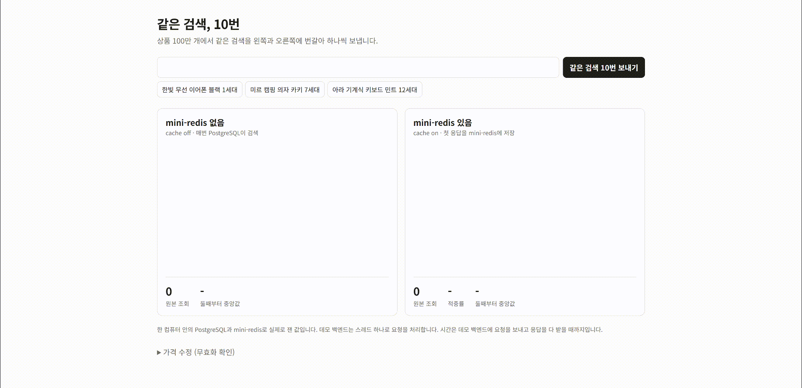
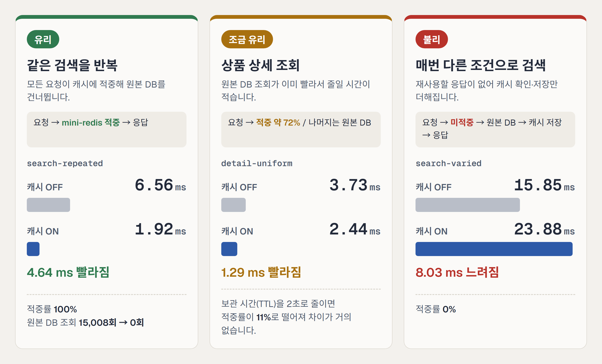
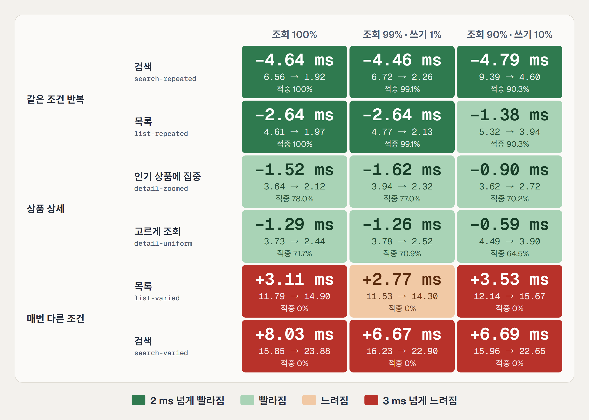

<!-- readme: archetype=team -->
<p align="center">
  
</p>

[](https://github.com/benjohnbill/mini-redis/actions/workflows/ci.yml)


Krafton Jungle 11–12주차 프로젝트입니다. C로 만든 키-값 저장소를 상품 API의 응답 캐시로 사용합니다.

[빠른 시작](#빠른-시작) · [API](#api) · [상품 조회 데모](#4--상품-조회-데모) · [성능 분석](#5--성능-분석) · [마일스톤](#마일스톤) · [문서](#문서)

## 1. ⭐ Redis 도입 배경

- 같은 상품을 반복해서 조회하면 DB도 같은 일을 반복합니다.
- 첫 응답을 메모리에 캐시해 두면 같은 상품을 다시 조회할 때 DB 조회를 건너뛰고 저장해 둔 응답을 돌려줄 수 있습니다.
- Redis가 이런 캐시로 널리 쓰이는 이유입니다.
- 이 동작을 직접 확인하려고 두 가지를 만들었습니다.

| 만든 것 | 하는 일 |
|---|---|
| mini-redis (`src/`) | HTTP로 key에 값을 저장하고, 읽고, 지울 수 있습니다. key마다 보관 기간(TTL)을 정할 수 있습니다. |
| 상품 데모 (`demo/`) | 상품 상세, 목록, 검색 API입니다. 원본 DB(SQLite 또는 PostgreSQL)에서 만든 응답을 mini-redis에 저장해 다시 사용합니다. |

- 응답 시간은 DB 조회를 얼마나 줄이는지와 캐시를 오가는 데 얼마나 걸리는지에 따라 달라집니다.
- [상품 조회 데모](#4--상품-조회-데모)에서 캐시 동작을 보여주고, [성능 분석](#5--성능-분석)에서 캐시를 켰을 때와 껐을 때의 응답 시간과 DB 조회 횟수를 비교합니다.

## 2. 기술 스택과 프로젝트 구조

### 기술 스택

| 영역 | 사용한 것 |
|---|---|
| 언어 | C11 |
| HTTP 서버 | [Mongoose](https://github.com/cesanta/mongoose) (`vendor/mongoose/`, 레포에 포함) |
| 해시 테이블 | Pintos `hash.c` 이식, key hash는 SipHash 1-2 |
| 상품 데모의 원본 DB | SQLite(기본) 또는 PostgreSQL(선택) |
| 테스트와 측정 | acutest(단위), Python 3(기능 테스트, 벤치마크), wrk |

### 프로젝트 구조

```
mini-redis/
├─ Makefile          make verify, make test, make bench, make cache-bench
├─ src/              mini-redis 서버 코드
├─ demo/             상품 데모(M5)와 그 README.md
├─ tests/            <마일스톤 이름>_test.c, functional/
├─ scripts/          check-ids.py, convention.py, bench/(측정 스크립트)
├─ docs/
│  ├─ api.md            HTTP 계약 전체
│  ├─ requirements.md   LMS 요구사항과 우리 해석
│  ├─ milestones/       마일스톤마다 overview.md, spec.md, issues/
│  ├─ measurements/     측정 기록
│  ├─ adr/              큰 설계 결정
│  └─ agents/           AI 스킬 설정
└─ .github/workflows/ci.yml
```

## 3. ⭐ 시스템 구조와 설계 결정

<p align="center">
  
</p>

서버는 프로세스 1개, 스레드 1개로 모든 요청을 처리합니다.

### GET 요청 처리 흐름

`GET /keys/greeting`이 들어오면 다음 순서로 값을 찾습니다.

```text
client → server.c  HTTP 요청을 받음
       → api.c     경로에서 greeting을 꺼냄
       → store.c   hash.c에 key를 찾도록 요청
           ↳ hash.c  SipHash로 검색할 버킷을 고르고 그 안에서 key를 찾음
       ← store.c   찾은 값이 아직 보관 기간 안에 있는지 확인
client ← 200과 저장한 값, 없거나 만료됐으면 404 key_not_found
```

### 설계 결정

| 주제 | 고른 것 | 이유와 기록 |
|---|---|---|
| HTTP 요청 형식 | `PUT`·`GET`·`DELETE /keys/<key>`, value는 body 바이트 그대로 | JSON으로 감싸지 않아 이미지 같은 바이트도 그대로 저장합니다. [ADR `http-methods-and-raw-body`](docs/adr/http-methods-and-raw-body.md) |
| 해시 테이블 | Pintos `hash.c`, 무작위 seed를 사용하는 SipHash 1-2 | 서버 밖에서 어떤 key가 같은 버킷에 들어갈지 예측하기 어렵게 합니다. [ADR `siphash-with-random-seed`](docs/adr/siphash-with-random-seed.md) |
| 해시 테이블을 늘릴 때 | key와 값을 묶은 entry를 여러 요청에 걸쳐 옮기는 점진적 rehash | 한 번에 옮기면 그동안 다른 요청이 수백 ms 기다립니다. [성능 개선 사례](#성능-개선-사례) |
| 동시 요청 | 스레드 1개의 이벤트 루프 | store를 동시에 부르지 않으므로 잠금이 필요 없습니다. [ADR `single-thread-event-loop`](docs/adr/single-thread-event-loop.md) |
| 만료 | `TTL` 헤더, 만료가 가까운 key부터 확인하는 자료구조(heap), 주기 청소 | 조회되지 않는 만료 key도 메모리에서 지웁니다. [ADR `ttl-in-request-header`](docs/adr/ttl-in-request-header.md), [ADR `expiry-heap-with-immediate-removal`](docs/adr/expiry-heap-with-immediate-removal.md) |
| 상품 수정 시 캐시 무효화 | 데모 백엔드가 그 상품의 상세 캐시와 목록·검색 캐시 전체를 무효화 | 상품 변경이 어느 응답에 영향을 주는지는 데모 백엔드가 판단합니다. [ADR `cache-invalidation-owned-by-demo-backend`](docs/adr/cache-invalidation-owned-by-demo-backend.md) |

## 4. ⭐ 상품 조회 데모

<p align="center">
  
</p>

같은 상품을 두 번 조회하면 첫 요청은 DB에서 읽고, 두 번째 요청은 캐시에 저장된 응답을 받습니다.

```text
첫 요청(MISS)    client → 상품 API → 캐시에 없음 → DB에서 조회해 응답을 만들고 캐시에 저장
두 번째 요청(HIT) client → 상품 API → 캐시에서 찾아 응답
```

데모를 시작하고 1번 상품을 60초 안에 두 번 조회하면 `/stats`에서 원본 조회 횟수를 확인할 수 있습니다.

| 조회 | 캐시 결과 | 이번 요청의 DB 조회 | `/stats`의 누적 `origin_queries` |
|---|---|---:|---:|
| 첫 조회 | MISS · DB 응답을 캐시에 저장 | 1회 | 1 |
| 두 번째 조회 | HIT · 저장한 응답을 반환 | 0회 | 1 |

SQLite 설치부터 상품 데이터 준비와 두 번의 조회까지 [상품 데모 실행 방법](demo/README.md#실행)에서 따라 할 수 있습니다.

## 5. ⭐ 성능 분석

### 측정 방법

| | mini-redis 서버만 실행 | 상품 API + mini-redis |
|---|---|---|
| **무엇을 확인했나** | 큰 값 저장이나 해시 테이블 확장 중에 **작은 조회가 얼마나 기다리는가** | 같은 상품 요청에서 캐시를 켜면 **응답 시간과 DB 조회 횟수가 얼마나 달라지는가** |
| **어떻게 비교했나** | 같은 부하에서 **코드 개선 전후** 비교 | 같은 요청에서 **캐시 OFF/ON** 비교 |

상품 API는 기준선과 최종 모두 **조회 패턴 6가지 × 조회·수정 비율 3가지 × TTL 2가지(60초·2초)**로, DB마다 **36개 조건**에서 캐시 OFF와 ON을 비교했습니다.

<details>
<summary>전체 시나리오 보기</summary>

`detail-uniform-99:1`은 여러 상품을 고르게 상세 조회하는 패턴에 조회 99%와 수정 1%를 섞은 시나리오입니다. 이름 뒤에 비율이 없으면 조회만 합니다.

| 조회 패턴 | 조회 100% | 조회 99% / 수정 1% | 조회 90% / 수정 10% |
|---|---|---|---|
| 상세 · 인기 상품에 집중 | `detail-zoomed` | `detail-zoomed-99:1` | `detail-zoomed-90:10` |
| 상세 · 상품을 고르게 조회 | `detail-uniform` | `detail-uniform-99:1` | `detail-uniform-90:10` |
| 목록 · 같은 조건 반복 | `list-repeated` | `list-repeated-99:1` | `list-repeated-90:10` |
| 목록 · 조건을 바꿔 조회 | `list-varied` | `list-varied-99:1` | `list-varied-90:10` |
| 검색 · 같은 조건 반복 | `search-repeated` | `search-repeated-99:1` | `search-repeated-90:10` |
| 검색 · 조건을 바꿔 조회 | `search-varied` | `search-varied-99:1` | `search-varied-90:10` |

</details>

[서버 측정 기록](docs/measurements/server/) · [상품 API 측정 기록](docs/measurements/cache-demo/)

### 성능 개선 사례

해시 테이블은 entry가 많아지면 버킷 배열을 키우고 entry를 새 배열로 옮깁니다. 이전에는 이 일을 저장 한 번에 모두 했습니다. 서버가 스레드 하나를 쓰기 때문에, 옮기는 동안 받은 작은 조회 요청도 기다렸습니다.

| 단계 | 버킷을 늘리는 저장 한 번 (ms) | 그때 작은 GET p99 (ms) | 기록 |
|---|---|---|---|
| 개선 전 | 531\~637 | 440\~546 | [`server/013`](docs/measurements/server/013-CJG-b1-baseline.md) |
| entry를 나눠 옮김 (#37) | 29\~56 | 0.68\~1.13 | [`server/014`](docs/measurements/server/014-CJG-pr37-incremental-rehash.md) |
| 버킷 초기화도 나눔 (#49) | 0.21\~0.29 | 0.66\~0.90 | [`server/024`](docs/measurements/server/024-CJG-lazy-buckets.md) |

같은 노트북과 명령으로 각 단계를 3번 측정한 범위입니다. p99는 요청의 약 99%가 이 시간 안에 끝났다는 뜻입니다. 작은 GET의 p99 목표는 10 ms 이하였습니다. [단계별 전체 결과](docs/milestones/perf/spec.md#측정-결과)

### 캐시는 언제 유리한가

- 같은 요청이 반복될수록 이득이 크고, 매번 다른 요청이면 캐시 확인·저장만 더해집니다.
- PostgreSQL, 최종 코드, TTL 60초, 조회만 하는 시나리오의 응답 시간 중앙값(p50)입니다. 세 카드의 막대는 같은 눈금입니다.

<p align="center">
  
</p>

### 캐시를 켜면 응답 시간이 얼마나 바뀌나

- 같은 조건을 반복하면 어느 칸에서나 빨라지고, 매번 다른 조건이면 어느 칸에서나 느려집니다.
- 칸의 큰 숫자는 캐시 ON p50 − OFF p50이고, 작은 숫자는 OFF → ON p50(ms)입니다. PostgreSQL, 최종 코드, TTL 60초입니다.

<p align="center">
  
</p>

[두 그림의 출처 · 최종 PostgreSQL 측정 결과 (`1a64bd7`)](docs/measurements/cache-demo/010-DA-postgres-final-grid.md)

## 6. 실행·API·테스트

### 빠른 시작

C11 컴파일러(`gcc` 또는 `clang`)와 `make`가 필요합니다.

```bash
make build/mini-redis    # 서버 빌드
./build/mini-redis 8080  # 8080 포트에서 실행
```

서버는 SIGTERM이나 SIGINT(Ctrl+C)를 받으면 끝납니다.

### API

HTTP 메서드로 저장·조회·삭제를 고르고, 경로 `/keys/<key>`에 key를 넣습니다. 저장할 값은 요청 본문(body)에 그대로 보냅니다.

| 요청 | 동작 |
|---|---|
| `PUT /keys/<key>` | body를 value로 저장합니다. 같은 key가 있으면 덮어씁니다. `TTL` 헤더로 보관 기간을 정할 수 있습니다. |
| `GET /keys/<key>` | 저장한 value를 body로 돌려줍니다. |
| `DELETE /keys/<key>` | key를 지웁니다. |
| `POST /mget` | body에 줄마다 적은 key(최대 64개)의 value를 한 응답으로 돌려줍니다. |
| `POST /mset` | body에 적은 key와 value 쌍(최대 64개)을 한 요청으로 저장합니다. |

성공하면 조회는 `200`과 value 바이트를, 저장과 삭제는 `204`를 받습니다. 오류는 상태 코드와 `{"error":"<오류 이유>"}` body로 알립니다.

저장합니다.

```console
$ curl -i -X PUT --data-binary "hello" http://127.0.0.1:8080/keys/greeting
HTTP/1.1 204 No Content

```

조회합니다.

```console
$ curl -i http://127.0.0.1:8080/keys/greeting
HTTP/1.1 200 OK
Content-Type: application/octet-stream
Content-Length: 5

hello
```

key 인코딩, `TTL` 헤더의 규칙, `POST /mget`과 `POST /mset`의 body 모양, 상한, 모든 상태 코드와 오류 이유는 [`docs/api.md`](docs/api.md)에 있습니다.

### 검증과 재현

**정확성 테스트**는 `make verify`로 실행합니다. mini-redis의 저장·조회·삭제·만료 동작과 오류 응답을 확인합니다. 상품 API는 `cache-functional`에서 조회 결과, 상품 수정 뒤 캐시 무효화, 캐시 장애 중 DB 조회와 장애 뒤 캐시 재개를 확인합니다.

아래 명령은 [빠른 시작](#빠른-시작)의 빌드 도구를 공통으로 사용합니다.

| 명령 | 추가로 필요한 도구 |
|---|---|
| `make test` | — |
| `make verify` | Python 3, clang-format 21.1.8, clang-tidy 21.1.6, [SQLite 개발 라이브러리](demo/README.md#실행) |
| `make bench` | Python 3, wrk |
| `make cache-bench` | Python 3, [SQLite 개발 라이브러리](demo/README.md#실행) |
| `make cache-bench-postgres` (선택) | Python 3, [PostgreSQL 서버와 libpq 개발 라이브러리](demo/README.md#성능-비교) |

```bash
sudo apt-get install wrk                            # Ubuntu에서 make bench를 실행할 때
pip install clang-format==21.1.8 clang-tidy==21.1.6  # make verify에 쓰는 CI와 같은 버전
```

```bash
make verify                 # 빌드, 단위·기능 테스트, ID 검사, lint (CI와 같은 명령)
make test                   # 단위 테스트만
make bench                  # mini-redis 서버 지연 측정
```

캐시 OFF/ON 비교는 [상품 데모의 SQLite·PostgreSQL 측정 방법](demo/README.md#성능-비교)을 따릅니다. 측정은 `make verify`와 CI에 들어가지 않습니다. 측정 결과는 한 번마다 파일 하나로 [`docs/measurements/`](docs/measurements/)에 남깁니다(`CONVENTION.md`의 "측정 기록").

## 7. 마일스톤과 참고 자료

### 마일스톤

| 순서 | 이름 | 주제 | 요구사항 | 상태 | 측정 | Redis와 대조 |
|---|---|---|---|---|---|---|
| M0 | — | 준비: Pintos `hash.c` 이식, 요청을 하나씩 받는 서버, 테스트 도구, CI | — | 완료 | — | — |
| M1 | [`store`](docs/milestones/store/overview.md) | 저장, 조회, 삭제 | L2 L4 L13 | 완료 | | [대조](docs/milestones/store/spec.md#redis와-대조) |
| M2 | [`api`](docs/milestones/api/overview.md) | 외부에서 부르기 | L3 L10 L14 | 진행 중 | | |
| M3 | [`concurrency`](docs/milestones/concurrency/overview.md) | 동시성 | L8 | 진행 중 | [server/001\~003](docs/measurements/server/) | [대조](docs/milestones/concurrency/spec.md#redis와-대조) |
| M4 | [`expire`](docs/milestones/expire/overview.md) | 보관 기간 | L9 | 진행 중 | [server/004](docs/measurements/server/004-CJG-expire-sweep.md) | [대조](docs/milestones/expire/spec.md#redis와-대조) |
| M5 | [`cache`](docs/milestones/cache/spec.md) | API 응답 캐시, 무효화, 성능 비교 | L15 L11 L17 | 진행 중 | [cache-demo 전체](docs/measurements/cache-demo/) | [대조](docs/milestones/cache/spec.md#redis와-대조) |
| M6 | `persist` | 서버가 꺼져도 데이터 유지 (선택) | L12 | 진행 전 | | |
| M7 | [`perf`](docs/milestones/perf/overview.md) | 측정된 증상을 원인별로 줄이는 성능 개선 | L8 L17 | 진행 중 | [측정 결과](docs/milestones/perf/spec.md#측정-결과) | |

요구사항 ID는 [`docs/requirements.md`](docs/requirements.md)에 있습니다. L16(엣지 케이스)은 모든 마일스톤의 테스트에 들어갑니다. `측정` 칸은 그 마일스톤의 측정 기록을 링크합니다. 마일스톤이 끝나면 `Redis와 대조` 칸에 그 `spec.md`의 `Redis와 대조` 절을 링크합니다.

### 알려진 한계

- eviction(메모리가 가득 찰 때 key를 내보내는 정책)은 LMS에 없어 구현하지 않습니다.
- **16 MiB 값을 저장하면 함께 들어온 작은 GET이 기다릴 수 있습니다.** 성능 개선 단계별 측정에서도 이 조건의 작은 GET p99는 목표인 10 ms를 넘었습니다. [서버 측정 결과](docs/milestones/perf/spec.md#측정-결과)
- **보관 기간과 연결에는 client가 알아야 할 한계가 있습니다.** 절전 중 멈추는 시계, 전송 지연만큼 늦는 만료, 느린 연결, `503` 뒤의 연결 리셋입니다([`docs/api.md`의 "한계"](docs/api.md#한계)).
- **응답 캐시 데모는 백엔드 한 프로세스와 넓은 무효화로 제한합니다.** 세부는 [`demo/README.md`의 "한계"](demo/README.md#한계)에 있습니다.

### 문서

- [`GLOSSARY.md`](GLOSSARY.md): 코드와 문서에서 쓰는 용어
- [`CONVENTION.md`](CONVENTION.md): 팀 규칙, 마일스톤 6단계, 문서 역할, 측정 기록
- [`docs/api.md`](docs/api.md): HTTP 계약 전체 (client 작성자용)
- [`demo/README.md`](demo/README.md): 상품 데모의 실행 방법과 HTTP 계약
- [`docs/requirements.md`](docs/requirements.md): 요구사항 표
- [`docs/measurements/`](docs/measurements/): 측정 기록. 측정 한 번마다 파일 하나
- [`docs/adr/`](docs/adr/): 큰 설계 결정
- [`AGENTS.md`](AGENTS.md): AI 에이전트가 먼저 읽는 파일

### 상표

이 프로젝트는 Krafton Jungle 과제로 만든 학습용 구현이며, Redis Ltd.가 보증, 지원, 인증하지 않습니다. This project is not endorsed, supported, or certified by Redis.

Redis® is a registered trademark of Redis Ltd. Any rights therein are reserved to Redis Ltd.

---

이민호 · 안다빈 · 조진근
