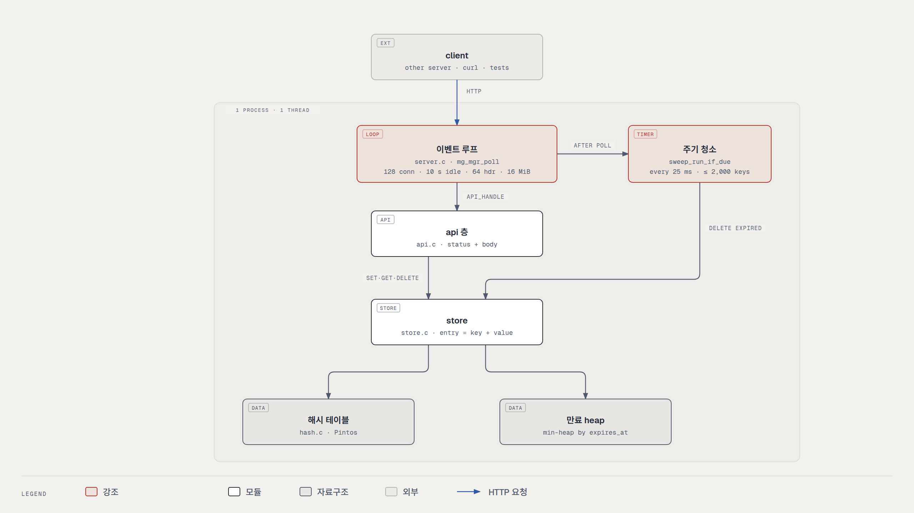

<!-- readme: archetype=team -->
<p align="center">
  
</p>

[](https://github.com/benjohnbill/mini-redis/actions/workflows/ci.yml)


Krafton Jungle Week 11-12: a key-value store on a hash table, usable through an API

[설치 및 실행](#설치-및-실행) · [API](#api) · [구조](#구조) · [응답 캐시 데모](#응답-캐시-데모) · [마일스톤](#마일스톤) · [알려진 한계](#알려진-한계) · [파일 트리](#파일-트리) · [문서](#문서)

## 설치 및 실행

필요한 도구는 쓰는 명령에 따라 다릅니다. CI는 `make verify`에 필요한 도구만 설치합니다.

| 명령 | 필요한 도구 |
|---|---|
| `make verify` | gcc 또는 clang(C11), make, python3, SQLite 개발 라이브러리, clang-format 21.1.8과 clang-tidy 21.1.6 |
| `make bench` | 위 도구와 wrk |
| `make cache-bench` | `make verify`와 같음 |
| `make cache-bench-postgres` (선택) | 위 도구와 PostgreSQL 서버, libpq 개발 파일(`pg_config`) |

```bash
sudo apt-get install libsqlite3-dev wrk              # Ubuntu. macOS는 Xcode Command Line Tools의 SQLite를 씁니다
pip install clang-format==21.1.8 clang-tidy==21.1.6  # CI와 같은 버전입니다(CONVENTION.md "코드")
```

```bash
make verify              # 빌드, 테스트, ID 검사 (CI와 같은 명령)
make test                # 테스트만 실행
make bench               # 서버 지연 측정. make verify와 CI에는 들어가지 않습니다
make cache-bench         # 캐시 on/off 비교 측정. make verify와 CI에는 들어가지 않습니다
./build/mini-redis 8080  # 서버 실행 (포트는 꼭 적습니다)
```

서버는 SIGTERM이나 SIGINT(Ctrl+C)를 받으면 끝납니다. 측정한 결과는 측정 한 번마다 파일 하나로 [`docs/measurements/`](docs/measurements/)에 남깁니다(`CONVENTION.md`의 "측정 기록").

## API

다른 서버는 HTTP로 mini-redis를 부릅니다. 동작은 메서드로, key는 경로 `/keys/<key>`로, value는 body의 바이트 그대로 나타냅니다.

| 요청 | 동작 |
|---|---|
| `PUT /keys/<key>` | body를 value로 저장합니다. 같은 key가 있으면 덮어씁니다. `TTL` 헤더로 보관 기간을 정할 수 있습니다. |
| `GET /keys/<key>` | 저장한 value를 body로 돌려줍니다. |
| `DELETE /keys/<key>` | key를 지웁니다. |

성공하면 조회는 `200`과 value 바이트를, 저장과 삭제는 `204`를 받습니다. 오류는 상태 코드와 `{"error":"<오류 이유>"}` body로 알립니다.

저장합니다.

```console
$ curl -i -X PUT --data-binary "hello" http://127.0.0.1:8080/keys/greeting
HTTP/1.1 204 No Content

```

조회합니다.

```console
$ curl -i http://127.0.0.1:8080/keys/greeting
HTTP/1.1 200 OK
Content-Type: application/octet-stream
Content-Length: 5

hello
```

key 인코딩, `TTL` 헤더의 규칙, body와 연결의 상한, 모든 상태 코드와 오류 이유, 오류의 우선순위는 [`docs/api.md`](docs/api.md)에 있습니다.

## 구조

<p align="center">
  
</p>

서버는 프로세스 1개, 스레드 1개로 모든 요청을 처리합니다([ADR `single-thread-event-loop`](docs/adr/single-thread-event-loop.md)). 그림의 원본은 [`docs/images/mini-redis-architecture.html`](docs/images/mini-redis-architecture.html)입니다.

## 응답 캐시 데모

M5에서 mini-redis를 상품 API의 응답 캐시로 쓰는 별도 실행 파일 `cache-demo`를 만들었습니다. 같은 조건을 반복하는 목록 조회는 적중률 100%로 원본 조회가 10초에 5,024번에서 0번이 되었습니다. 상세 조회는 적중률 36\~53%만큼 원본 조회가 줄었지만, 데모가 mini-redis 왕복을 기다리느라 더 느려졌습니다. WSL2에서 잰 p50은 반복 목록이 약 28\~32 ms에서 약 6 ms로 줄고, 상세 균등이 약 1.4 ms에서 약 8.6 ms로 늘었습니다([004](docs/measurements/cache-demo/004-CJG-sqlite-grid.md)).

- 실행 방법과 HTTP 계약: [`demo/README.md`](demo/README.md)
- 측정 결론: [`docs/milestones/cache/spec.md`의 "측정 결과"](docs/milestones/cache/spec.md#측정-결과). 측정 기록은 아래 마일스톤 표의 `측정` 칸에 있습니다.

## 마일스톤

| 순서 | 이름 | 주제 | 요구사항 | 상태 | 측정 | Redis와 대조 |
|---|---|---|---|---|---|---|
| M0 | — | 준비: Pintos `hash.c` 이식, 요청을 하나씩 받는 서버, 테스트 도구, CI | — | 완료 | — | — |
| M1 | [`store`](docs/milestones/store/overview.md) | 저장, 조회, 삭제 | L2 L4 L13 | 완료 | | [대조](docs/milestones/store/spec.md#redis와-대조) |
| M2 | [`api`](docs/milestones/api/overview.md) | 외부에서 부르기 | L3 L10 L14 | 진행 중 | | |
| M3 | [`concurrency`](docs/milestones/concurrency/overview.md) | 동시성 | L8 | 진행 중 | [server/001\~003](docs/measurements/server/) | [대조](docs/milestones/concurrency/spec.md#redis와-대조) |
| M4 | [`expire`](docs/milestones/expire/overview.md) | 보관 기간 | L9 | 진행 중 | [server/004](docs/measurements/server/004-CJG-expire-sweep.md) | [대조](docs/milestones/expire/spec.md#redis와-대조) |
| M5 | [`cache`](docs/milestones/cache/spec.md) | API 응답 캐시, 무효화, 성능 비교 | L15 L11 L17 | 진행 중 | [cache-demo/001\~004](docs/measurements/cache-demo/) | [대조](docs/milestones/cache/spec.md#redis와-대조) |
| M6 | `persist` | 서버가 꺼져도 데이터 유지 (선택) | L12 | 진행 전 | | |
| M7 | [`perf`](docs/milestones/perf/overview.md) | 측정된 증상을 원인별로 줄이는 성능 개선 | L8 L17 | 진행 중 | [server/005](docs/measurements/server/005-CJG-baseline.md) | |

요구사항 ID는 [`docs/requirements.md`](docs/requirements.md)에 있습니다. L16(엣지 케이스)은 모든 마일스톤의 테스트에 들어갑니다. `측정` 칸은 그 마일스톤의 측정 기록을 링크합니다. 마일스톤이 끝나면 `Redis와 대조` 칸에 그 `spec.md`의 `Redis와 대조` 절을 링크합니다.

## 알려진 한계

- eviction(메모리가 가득 찰 때 key를 내보내는 정책)은 LMS에 없어 구현하지 않습니다.
- **key 수가 2배로 늘어나는 순간 서버가 한 번 멈춥니다.** store가 약 13만 개를 넘으면 그 멈춤이 M3의 목표(작은 GET의 p99 10 ms 이하)를 넘고, 400만 개에서는 약 310\~350 ms입니다([측정 결과](docs/milestones/concurrency/spec.md#측정-결과)).
- **16 MiB value를 저장하는 동안 서버가 약 12 ms 멈춥니다.** 상한 크기의 value를 초당 5번 저장하면 작은 GET의 p99가 목표를 약 1 ms 넘습니다([측정 결과](docs/milestones/concurrency/spec.md#측정-결과)).
- **요청이 없어도 서버가 초당 40번 깨어납니다.** 주기 청소가 25 ms 간격을 지키기 때문입니다([측정 결과](docs/milestones/expire/spec.md#측정-결과)).
- **key의 해시에 무작위 seed를 섞지 않습니다.** 같은 버킷에 떨어지는 key를 골라 넣으면 조회가 느려집니다([Redis와 대조](docs/milestones/store/spec.md#redis와-대조)).
- **보관 기간과 연결에는 client가 알아야 할 한계가 있습니다.** 절전 중 멈추는 시계, 전송 지연만큼 늦는 만료, 느린 연결, `503` 뒤의 연결 리셋입니다([`docs/api.md`의 "한계"](docs/api.md#한계)).
- **응답 캐시 데모는 백엔드 한 프로세스와 넓은 무효화로 제한합니다.** 세부는 [`demo/README.md`의 "한계"](demo/README.md#한계)에 있습니다.

## 파일 트리

```
mini-redis/
├─ Makefile          make verify, make test, make bench, make cache-bench
├─ src/              소스 코드
├─ demo/             상품 데모(M5)와 그 README.md
├─ tests/            <마일스톤 이름>_test.c, functional/
├─ scripts/          check-ids.py, convention.py, bench/(측정 스크립트)
├─ docs/
│  ├─ api.md            HTTP 계약 전체
│  ├─ requirements.md   LMS 요구사항과 우리 해석
│  ├─ milestones/       마일스톤마다 overview.md, spec.md, issues/
│  ├─ measurements/     측정 기록(server/, cache-demo/)
│  ├─ adr/              큰 설계 결정
│  └─ agents/           AI 스킬 설정
└─ .github/workflows/ci.yml
```

## 문서

- [`GLOSSARY.md`](GLOSSARY.md): 코드와 문서에서 쓰는 용어
- [`CONVENTION.md`](CONVENTION.md): 팀 규칙, 마일스톤 6단계, 문서 역할, 측정 기록
- [`docs/api.md`](docs/api.md): HTTP 계약 전체 (client 작성자용)
- [`demo/README.md`](demo/README.md): 상품 데모의 실행 방법과 HTTP 계약
- [`docs/requirements.md`](docs/requirements.md): 요구사항 표
- [`docs/measurements/`](docs/measurements/): 측정 기록. 측정 한 번마다 파일 하나
- [`docs/adr/`](docs/adr/): 큰 설계 결정
- [`AGENTS.md`](AGENTS.md): AI 에이전트가 먼저 읽는 파일

### Team

이민호 · 안다빈 · 조진근

### 상표

이 프로젝트는 Krafton Jungle 과제로 만든 학습용 구현이며, Redis Ltd.가 보증, 지원, 인증하지 않습니다. This project is not endorsed, supported, or certified by Redis.

Redis® is a registered trademark of Redis Ltd. Any rights therein are reserved to Redis Ltd.
