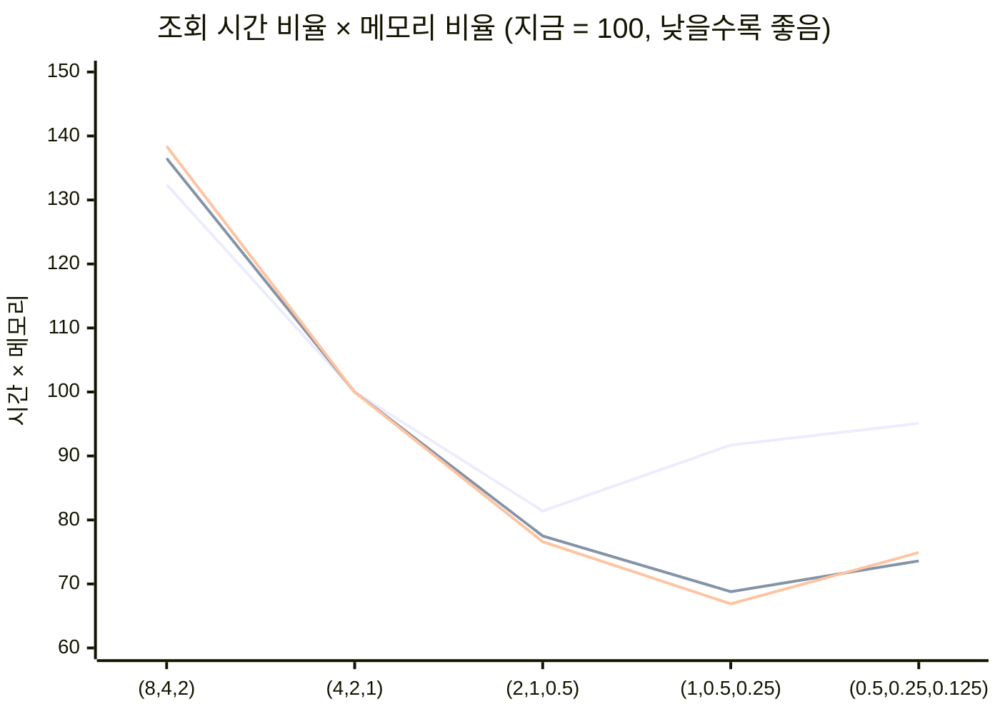

# 001 rehash 범위 다섯 설정의 조회 시간과 메모리

## 앞 기록과 달라진 점

- **목적:** `src/hash.c`의 rehash 범위(위쪽 경계, 목표, 아래쪽 경계)를 바꾸면 조회 시간과 메모리가 어떻게 달라지는지 서버 없이 잽니다. 이 폴더의 첫 기록입니다.
- **도구:** `scripts/bench/rehash_micro.c`가 store 함수를 직접 부릅니다. `store_set`으로 `prefill-0`부터 key를 차례로 넣고(value 100바이트), 같은 key를 무작위 순서로 `store_get`합니다. 설정마다 `src/*.c`를 `-D`로 따로 빌드한 바이너리를 회마다 번갈아 실행합니다.
- **머신:** [`server/005`](../server/005-CJG-baseline.md)와 같은 머신입니다.

## 결론

`조회 시간 비율 × 메모리 비율`(지금 설정 (4, 2, 1) = 100)이 가장 작은 설정은 key 1,048,576개와 4,194,304개에서 (1, 0.5, 0.25)이고, key 100,000개에서 (2, 1, 0.5)입니다.

| 설정 | 10만 key | 100만 key | 400만 key |
|---|---|---|---|
| (8, 4, 2) | 132.4 | 136.5 | 138.4 |
| (4, 2, 1) 지금 | 100 | 100 | 100 |
| (2, 1, 0.5) | **81.4** | 77.5 | 76.6 |
| (1, 0.5, 0.25) | 91.7 | **68.8** | **66.9** |
| (0.5, 0.25, 0.125) | 95.1 | 73.6 | 74.9 |

- **이 지표는 시간 1%와 메모리 1%를 같은 값으로 칩니다.** 메모리가 더 귀한 환경이면 최적 설정이 (2, 1, 0.5) 쪽으로 옮겨 갑니다.
- **key 10만 개는 회마다 흔들립니다.** 같은 날 커밋하기 전의 코드로 잰 실행에서는 (2, 1, 0.5)가 80.1, (1, 0.5, 0.25)가 80.0으로 같았습니다. entry 전체가 약 20 MB라서 CPU 캐시에 상당 부분 들어가고, 비교 한 번이 싸서 설정의 차이가 작기 때문으로 봅니다.
- **범위를 좁히면 가장 긴 멈춤이 길어집니다.** key 400만 개에서 (4, 2, 1)은 117.4\~139.8 ms, (1, 0.5, 0.25)는 179.4\~261.2 ms였습니다. 이 지표에는 멈춤이 들어 있지 않습니다.

## 결과

시간은 3회의 범위이고, `중앙값`은 3회의 중앙값입니다. 조회와 저장은 한 번의 평균 시간(ns)이고, 멈춤은 `store_set` 한 번의 최대 시간(ms)입니다. RSS는 key를 넣기 전과 다 넣은 뒤의 프로세스 RSS 차이를 key 수로 나눈 값(바이트)이며, 3회 모두 같았습니다.

### key 100,000개

| 설정 | 조회 | 조회 중앙값 | 저장 중앙값 | 가장 긴 멈춤 | key 하나당 RSS | 버킷 수 |
|---|---|---|---|---|---|---|
| (8, 4, 2) | 903\~1,026 | 918 | 442 | 2.5\~4.3 | 198.6 | 16,384 |
| (4, 2, 1) | 665\~817 | 675 | 407 | 3.4\~4.1 | 203.9 | 32,768 |
| (2, 1, 0.5) | 503\~568 | 523 | 343 | 2.9\~3.7 | 214.3 | 65,536 |
| (1, 0.5, 0.25) | 506\~539 | 536 | 361 | 4.9\~6.8 | 235.3 | 131,072 |
| (0.5, 0.25, 0.125) | 452\~506 | 472 | 409 | 7.7\~9.9 | 277.3 | 262,144 |

### key 1,048,576개

| 설정 | 조회 | 조회 중앙값 | 저장 중앙값 | 가장 긴 멈춤 | key 하나당 RSS | 버킷 수 |
|---|---|---|---|---|---|---|
| (8, 4, 2) | 2,037\~2,151 | 2,055 | 850 | 34.4\~37.3 | 196.1 | 131,072 |
| (4, 2, 1) | 1,368\~1,490 | 1,475 | 581 | 29.3\~32.8 | 200.1 | 262,144 |
| (2, 1, 0.5) | 1,062\~1,163 | 1,100 | 465 | 32.6\~39.0 | 208.1 | 524,288 |
| (1, 0.5, 0.25) | 897\~931 | 906 | 422 | 41.3\~49.0 | 224.1 | 1,048,576 |
| (0.5, 0.25, 0.125) | 783\~863 | 848 | 407 | 63.9\~66.6 | 256.1 | 2,097,152 |

### key 4,194,304개

| 설정 | 조회 | 조회 중앙값 | 저장 중앙값 | 가장 긴 멈춤 | key 하나당 RSS | 버킷 수 |
|---|---|---|---|---|---|---|
| (8, 4, 2) | 2,428\~2,856 | 2,841 | 958 | 145.3\~166.4 | 196.0 | 524,288 |
| (4, 2, 1) | 1,985\~2,442 | 2,012 | 636 | 117.4\~139.8 | 200.0 | 1,048,576 |
| (2, 1, 0.5) | 1,468\~1,665 | 1,481 | 480 | 134.7\~204.0 | 208.0 | 2,097,152 |
| (1, 0.5, 0.25) | 1,146\~1,216 | 1,201 | 412 | 179.4\~261.2 | 224.0 | 4,194,304 |
| (0.5, 0.25, 0.125) | 1,150\~1,183 | 1,177 | 411 | 251.5\~259.5 | 256.0 | 8,388,608 |

## 결론의 근거

- **세 경계를 같은 비율로 줄인 이유:** 지금 설정 (4, 2, 1)의 비율을 유지했습니다. 아래쪽 경계가 위쪽 경계보다 크면 범위가 비고, `rehash`는 저장마다 이상적인 버킷 수를 다시 계산하는 M3 이전의 동작으로 돌아갑니다. 버킷 수와 rehash 횟수는 모든 설정에서 측정 전에 계산한 값과 같았습니다.
- **조회가 빨라진 이유:** 범위를 좁히면 버킷당 평균 entry가 줄어 GET 한 번의 평균 비교 횟수(1 + 평균 ÷ 2)가 줄어듭니다. key가 100만 개를 넘으면 entry가 캐시에 없어서 비교 한 번이 메모리를 한 번 읽는 시간이 되므로, 비교를 줄인 효과가 크게 드러납니다. 찾는 key 자신과의 비교 1번은 줄일 수 없어서, 버킷당 평균 entry가 1개 아래로 내려가면 이득이 작아집니다.
- **key 하나당 RSS:** 지금 버킷 배열의 몫(버킷 수 × 16바이트 ÷ key 수)보다 한 단계마다 약 두 배씩 늘어납니다. rehash가 해제한 이전 버킷 배열을 malloc이 운영체제에 돌려주지 않고 들고 있는 것으로 보지만, 확인하지 않았습니다. 프로세스가 실제로 차지한 메모리이므로 메모리 비율은 RSS 그대로 계산했습니다.
- **멈춤이 길어진 이유:** key 400만 개에서는 다섯 설정 모두 가장 큰 rehash가 key 2,097,153개째에서 일어나 같은 수의 entry를 옮깁니다. 범위를 좁힐수록 rehash가 새로 할당하고 초기화하는 버킷 배열이 두 배씩 커지는 것이 차이로 보지만, 두 시간을 따로 재지는 않았습니다.
- **이 측정은 저장과 조회만 합니다.** 경계 근처에서 저장과 삭제가 번갈아 오는 경우와 서버 전체의 전후는 [`server/006`](../server/006-CJG-rehash-thresholds-before.md)과 [`server/007`](../server/007-CJG-rehash-thresholds-after.md)이 맡습니다.
